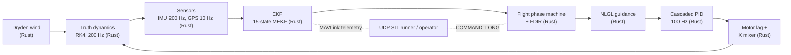

<p align="center"></p>

# Talon FlightLab: UAV Autopilot Simulator

Talon FlightLab is a drone autopilot simulator you can fly and inspect in the browser. It pairs a validated guidance, navigation, and control (GNC) core with a web tool that presents the results: a replayable 3D flight, live telemetry channels, the automated validation report, the recorded flight videos, a mission editor, and a live run that executes the autopilot itself in the browser.

The core is a complete autopilot for a 1.5 kg Crazyflie-class quadrotor: a 15-state multiplicative error-state Kalman filter, NLGL line-of-sight guidance, reactive obstacle avoidance, a cascaded PID controller, an 8-state flight-phase state machine with FDIR, and a UDP MAVLink software-in-the-loop (SIL) runner, all closed loop against a Rust rigid-body truth plant. The autopilot is one Rust library, `talon-core`: the browser runs it through WebAssembly (`wasm/`, wasm-bindgen) and the Python analysis harness runs it through a PyO3 extension (`bindings/`, exposing `talon._core`). The recorded-run glue (the mission manager, guidance, sensors, motors, battery, and the MAVLink SIL edge) and the analysis tooling are Python, and they call into the same core.

## Run the app

The web app is the repository root (Vite + React).

```bash
npm install
npm run dev      # dev server at http://localhost:5173/Talon/
npm run build    # typecheck + production build into dist/
npm run preview  # serve the built site at http://localhost:4173/Talon/
npm test         # vitest unit tests
```

The app is a GitHub Pages *project* site, served from a subpath
(`https://ajeet-krish.github.io/Talon/`), so Vite's `base` is `/Talon/` and the dev and preview servers use the same prefix. Override it for a root-served local session with `VITE_BASE=/ npm run dev`. The deploy workflow derives the base from the repository name at build time, so it follows a rename without any edit here.

Deployment requires the repository's Pages source to be set to
**GitHub Actions** (Settings > Pages > Build and deployment > Source). Left on "Deploy from a branch", GitHub publishes the raw repository through Jekyll and the site serves an untranspiled `index.html`.

The Run section needs the WebAssembly kernel. Build it once with
`./wasm/build.sh` (needs wasm-pack and the wasm32 target); the built bundle is committed under `public/wasm-rust/`, so a fresh clone can run it without the toolchain. Without a built bundle, every other section still works and Run disables itself with a clear message.

## Sections

One entry point, six sections (the replay and telemetry sections share the playback clock; the left rail carries the recorded scenario list, and the mission editor owns the full width):

- **Mission**: author a mission on a north-up planning chart. Add, drag, and reorder waypoints with altitude, leg speed, and acceptance radius; set steady wind and turbulence; place keep-out zones and toggle reactive avoidance; schedule faults on a timeline; read a pre-flight summary and named validation errors; import and export mission JSON. Fly sends the validated mission into the live Run pipeline.
- **Replay**: a full-bleed 3D scene. Scrub a recorded flight and read the autopilot working: EKF state estimation with a 3-sigma covariance ellipsoid, the flight-phase state machine (phase-colored trail and phase-segmented timeline), NLGL guidance, and detour avoidance around spherical keep-out zones with a live clearance readout.
- **Telemetry**: the recorded channels as time-series (altitude, ground speed, EKF error, wind, thrust, 3-sigma, obstacle clearance).
- **Metrics**: a run summary derived from the active scenario plus the validation driver's own acceptance table.
- **Videos**: the recorded Matplotlib flight exports, with an "open in replay" jump for the runs that have a scenario.
- **Run**: fly a scenario in the browser. The Rust autopilot compiled to WebAssembly is stepped by the page at 200 Hz plant / 100 Hz control / 10 Hz GPS, with the pacing owned by the front end; the finished run appears in the rail and drops into Replay, Telemetry, and Metrics like a recorded flight. The "Reactive avoidance" scenario flies the plain circuit straight through three keep-out spheres, so the autopilot has to see each zone and deviate around it while it flies.

## Highlights

- **15-state MEKF**: position, velocity, attitude (multiplicative error), gyro bias, accel bias; chi2-gated 10 Hz GPS updates, covariance-based convergence and divergence detection.
- **Cascaded PID autopilot** at 100 Hz with zero-order hold: position PID outer loop with back-calculation anti-windup, attitude / rate PD inner loop, saturating mixer-aware commands, 200 Hz RK4 truth with first-order motor lag.
- **NLGL guidance** (Park, Deyst and How 2004, ArduPilot clipped form): look-ahead line-of-sight steering with ground-velocity Nu2, behind-A recovery, and per-leg cross-track diagnostics.
- **Flight-phase state machine**: IDLE, ARM, TAKEOFF, CRUISE, WAYPOINT, RTL, LAND, EMERGENCY with guarded transitions, an event audit log, and automatic critical-fault response to EKF divergence.
- **UDP MAVLink SIL**: real MAVLink v2 frames (pymavlink codec) for telemetry (HEARTBEAT, ATTITUDE, LOCAL_POSITION_NED, GPS_RAW_INT, BATTERY_STATUS) and COMMAND_LONG events on loopback ports 14550/14551, plus fault injection (GPS outage, EKF corruption, battery drain).
- **Native reactive avoidance**: spherical keep-out zones are a core layer (`core/src/avoidance.rs`). A zone that covers the active leg inside the lookahead gets a bypass point substituted for the waypoint, the latch is retired once the clearance recovers, and the run reports the minimum 3-D surface clearance it achieved plus the number of bypasses taken. The offline leg-detour planner that inserts detour waypoints before a run keeps working and now delegates to the same geometry, and the schema 1.1 telemetry export still carries the zones so the web scene can render them.
- **7 closed-loop scenarios** with printed acceptance metrics, plus a validation driver that runs everything, generates seven publication plots and five flight videos, exports schema 1.1 telemetry JSON, and writes an automated validation report plus a machine-readable copy.
- **Mission authoring**: a 2D planning chart and inspector over the generated scenario config, with a pure command and undo history, a persisted draft, validation against the core's own limits, JSON import and export, and a Fly handoff into the existing WASM run. Waypoints, wind, keep-out zones, and scheduled faults are authored data the Rust core applies; the editor never re-implements flight math.
- **In-browser WASM run**: the same Rust autopilot (dynamics, Dryden wind, cascaded PID, 15-state MEKF, NLGL guidance, reactive avoidance, mission, phase machine, sensors, motors) compiled to WebAssembly with wasm-bindgen, so hover, waypoints, obstacle field, reactive avoidance, and wind fly live in the browser with no server round trip and no second implementation of the flight-critical math.
- **Test suites**: 399 pytest, 265 Rust core, 16 wasm-binding, 13 PyO3 marshalling, and 357 vitest, all passing.

## Architecture

Data flow of one 200 Hz SIL step (sensors and estimator at their own rates, controller at 100 Hz):



The Rust core implements the whole loop; the Python harness keeps its own
higher-level layers for the recorded runs and takes the plant, controller,
estimator and avoidance geometry from the Rust `_core`:

| Layer | Rust core (`core/src/`) | Python (`python/talon/`) |
|-------|-------------------------|--------------------------|
| Dynamics / RK4 | `dynamics.rs` (`propagate`) | via `_core` (`bindings/`) |
| Wind | `wind.rs` (`DrydenWind`) | via `_core` (`bindings/`) |
| Controller | `controller.rs` (cascaded PID) | via `_core` (`bindings/`) |
| Estimator | `ekf.rs` (15-state MEKF) | via `_core` (`bindings/`) |
| Motors | `motors.rs` (lag + X mixer) | `motors.py` (harness) |
| Sensors | `sensors.rs` (truth-side IMU/GPS) | `sensors.py` (harness) |
| Guidance / mission | `guidance.rs` (NLGL), `mission.rs` | `guidance.py`, `mission.py` (harness) |
| Obstacle avoidance | `avoidance.rs` (reactive law + geometry) | `avoidance.py` (planner, via `_core`) |
| State machine / FDIR | `state_machine.rs` | `state_machine.py` (harness) |
| SIL loop | `sim.rs` (pure stepper, no transport) | `mavlink_sil.py` + `mavlink_codec.py` (MAVLink edge) |
| Battery | `battery.rs` | `battery.py` (harness) |
| Plots / report / video | - | `plotting.py`, `export_json.py`, `animation.py` |

The web app consumes the exported JSON and the validation report for the
recorded sections. The Run section adds a second, browser-side path to the
same core: `wasm/` exposes a steppable `Session` (wasm-bindgen) and
`src/live/` owns only the front-end concerns, the engine loader, the sample
recorder, the pacer and the display geometry. There is no TypeScript
autopilot: mission, guidance, avoidance, motors, sensors, the phase machine and
the SIL loop all run in the native core. The live-run configs are exported from
the Python scenario definitions by `python/sims/export_live_configs.py`, so the
browser can never drift from the recorder.

## Build and test

The autopilot is a Rust workspace: `core/` is `talon-core`, `wasm/` is the
wasm-bindgen wrapper and `bindings/` is the PyO3 wrapper. The Python extension
`talon._core` is built by `bindings/build.sh` (not by the Python build
backend). From the repository root:

```bash
cargo test --workspace               # 265 core + 16 wasm + 13 PyO3 tests

uv sync                              # Python environment (.venv)
./bindings/build.sh                  # -> python/talon/_core<EXT_SUFFIX>
uv run pytest python/tests/ -q       # 399 Python tests

uv run python python/sims/run_all.py # 7 scenarios + plots + videos + reports

# WebAssembly kernel for the in-browser live run
./wasm/build.sh                      # -> public/wasm-rust/talon_core.js + _bg.wasm
```

`.cargo/config.toml` points `PYO3_PYTHON` at `.venv/bin/python`, so `cargo` and
`uv run pytest` always build and import the extension against the same
interpreter. `./bindings/build.sh debug` skips the release optimisations.

Individual scenarios also run standalone, for example
`uv run python python/sims/scenario_waypoints.py`. The validation driver writes `plots/*.png`, `plots/validation_report.md`, and `plots/json/validation.json` (the plots/ directory is gitignored; regenerate
on demand).

To refresh the web app's telemetry and recordings after a driver run:

```bash
scripts/copy_data.sh   # copies plots/json/*.json and docs/videos/*.mp4 into public/
                       # and regenerates public/data/live/configs.json
```

## Scenarios

| Scenario | Purpose | Key metric |
|----------|---------|------------|
| `scenario_hover` | Cascaded PID closed-loop hover with motor lag, calm air | steady-state drift < 0.05 m (achieved < 0.001 m) |
| `scenario_waypoints` | NLGL 40x30 m rectangle at 10 m under Dryden wind, full EKF-in-the-loop stack | mean cross-track 0.65 m, EKF RMSE 0.10 m |
| `scenario_rtl` | Low-battery fault injection, return-to-launch, gentle touchdown | 0.40 m/s touchdown, 0.07 m from home |
| `scenario_wind` | 60 s hover hold in 4-6 m/s airflow versus a calm baseline, SIL state machine | windy RMS 0.09 m inside the 0.25 m bound |
| `scenario_gps_outage` | 4 s mid-mission GPS blackout: dead-reckon, reconverge, no EMERGENCY | 0.69 m error growth, 0.01 s reconvergence |
| `scenario_emergency` | EKF position corruption at hover: FDIR detection and controlled descent | detection 0.00 s, soft settled landing |
| `scenario_obstacle_field` | 40x30 m circuit at 10 m through three spherical keep-out zones, detour planner + full EKF loop | 8/8 waypoints at 2.07 m minimum 3-D clearance |

## Validation summary

Headline numbers from `uv run python python/sims/run_all.py` (the full 25-row table lands in `plots/validation_report.md` on every run, and the same rows land in `plots/json/validation.json` for the web report):

| Metric | Target | Achieved |
|--------|--------|----------|
| Hover steady-state drift | < 0.05 m | 0.005 m |
| Position step rise time / overshoot | < 2.5 s / < 10 % | 1.29 s / 8.2 % |
| EKF position RMSE (waypoint circuit) | < 2.0 m | 0.102 m |
| Gyro bias estimate (max axis) | < 0.01 rad/s | 0.00177 rad/s |
| NLGL mean / max cross-track (after 15 s) | < 1.0 m / < 3.0 m | 0.650 m / 1.967 m |
| Waypoints reached | 5 of 5 | 5 of 5 |
| RTL touchdown: horizontal / vertical speed | < 3 m / < 0.5 m/s | 0.070 m / 0.398 m/s |
| Wind hover RMS (vs baseline-scaled bound) | < max(0.25, ...) m | 0.094 m |
| GPS outage error growth / reconvergence | < 5 m / < 5 s | 0.686 m / 0.01 s |
| Obstacle field min 3-D surface clearance | > 0 m | 2.072 m |
| Emergency detection / final altitude | < 1 s / < 0.5 m | 0.000 s / settled |
| State machine phases covered (SIL union) | 8 of 8 | 8 of 8 |
| Test suites | 139+ pytest | 399 pytest, 265 Rust core, 357 vitest |

Two example plots (generated by the validation driver into the gitignored `plots/` directory; regenerate with `uv run python python/sims/run_all.py`):


*3D NED truth trajectory with waypoint and home markers: takeoff climb, two 40 m legs at 10 m, then the RTL climb-over-home and descent. The cross-track samples for both legs come from the NLGL diagnostics.*


*Flight-phase Gantt from the emergency scenario: the corrupted EKF estimate trips `critical_fault` at 20 s, the machine owns a controlled descent through EMERGENCY and LAND, and the settled vehicle returns to IDLE. Dotted lines are accepted guarded events; down-ticks are rejected attempts in the audit log.*

Note: `plots/` is gitignored, so the two images embedded above do not render on GitHub. Generate them locally with `uv run python python/sims/run_all.py` and open `plots/*.png` on disk.

## Frames and conventions

NED world frame, aerospace body frame, Hamilton scalar-first quaternions, thrust along -body-z, gravity [0, 0, +g] in NED. The full single source of truth for frames, signs, units, and the motor mixer is [docs/conventions.md](docs/conventions.md); the Rust core is the reference implementation, and every Python module and web-app type is checked against it.

## Guidance note

Talon's guidance law is Nonlinear Linear guidance (NLGL) in the form of
Park, Deyst and How (2004), implemented in the scalar ArduPilot
AP_L1_Control style: look-ahead distance L1 = zeta * T * V / pi, a
clipped cross-track capture angle Nu1, and a course error Nu2 measured
from the EKF ground-velocity vector (mandatory for wind immunity: the
crab angle cancels exactly in Nu2). The commanded course is
chi_d = chi_q + Nu with Nu clipped to +/-90 deg, the ArduPilot form that
keeps L1 globally convergent; the unclipped Nu1 + Nu2 sum has a
wrong-way equilibrium at corners. Altitude rides a separate P/PD channel
on the active waypoint's NED z. Waypoint sequencing, acceptance radii,
and the first-leg start-position rule live in `talon.mission`; the law
itself is a pure function with per-call diagnostics (`e_ct`, `nu1`,
`nu2`, `l1`, `chi_d`).

## Talon versus SwarmGNC

| Aspect | Talon | SwarmGNC |
|--------|-------|----------|
| Scope | Single vehicle, full onboard GNC | Multi-agent swarm, coordination research |
| Navigation | 15-state MEKF (GPS + IMU, bias estimation) | Truth-state (formation study isolates control) |
| Control | Cascaded PID with motor lag and mixer saturation | LQR consensus controllers |
| Guidance | NLGL line-of-sight path following | DCM-based formation keeping |
| Fault handling | FDIR state machine, emergency landing | Not in scope |
| Presentation | FlightLab web simulator (replay, telemetry, metrics) | Static 3D viewer |

Talon and SwarmGNC are complementary portfolio projects: Talon is the
flagship flight-dynamics project proving estimation and control honesty
on one airframe; SwarmGNC remains the active project for multi-agent
work.

## Portfolio narrative

Talon is the flagship of the flight-dynamics portfolio: a single-vehicle
autopilot where the estimator is in the loop, the wind is modeled, the
faults are injected, and every headline number is produced by an
automated report rather than by hand. FlightLab is the presentation layer:
the same validated runs, replayable and inspectable in the browser.
SwarmGNC remains the active project for multi-agent formation flight;
Talon is what makes the single-agent layer underneath that research
trustworthy.

## References

1. Beard, R. W. and McLain, T. W. *Small Unmanned Aircraft: Theory and
   Practice*. Princeton University Press, 2012. (Cascaded autopilot
   design, path following, Dryden wind model.)
2. Trawny, N. and Roumeliotis, S. I. "Indirect Kalman Filter for 3D
   Attitude Estimation." University of Minnesota, GRASP Laboratory,
   2005. (MEKF formulation used by `ekf.rs`.)
3. Solà, J. "Quaternion kinematics for the error-state Kalman filter."
   arXiv:1711.02508, 2017. (Multiplicative error-state conventions.)
4. Park, S., Deyst, J. and How, J. P. "Performance and Lyapunov
   stability of a nonlinear path-following guidance law." *AIAA Journal
   of Guidance, Control, and Dynamics*, 2007 (with the 2004 conference
   precursor). (NLGL guidance law.)
5. Nelson, D. B. *Flight Stability and Automatic Control*. McGraw-Hill,
   1998. (Aerospace frame and rigid-body context.)
6. Groves, P. D. *Principles of GNSS, Inertial, and Multisensor
   Integrated Navigation Systems*. Artech House, 2013. (GPS measurement
   modeling and sensor fusion practice.)
7. MIL-F-8785C. *Military Specification: Flying Qualities of Piloted
   Airplanes*. (Turbulence severity context for the Dryden spectrum.)
8. Quan, Q. *Introduction to Multicopter Design and Control*. Springer,
   2017. (Quadrotor modeling, mixer, and motor dynamics.)
9. Mellinger, D. and Kumar, V. "Minimum snap trajectory generation and
   control for quadrotors." *IEEE ICRA*, 2011. (Reference for
   trajectory-tracking performance expectations on small quadrotors.)
10. Lee, T., Leoky, M. and McClamroch, N. H. "Geometric tracking
    control of a quadrotor UAV on SE(3)." *IEEE CDC*, 2010.
    (Geometric-control contrast to the cascaded PID used here.)

## Layout

```
Talon/
├── index.html               # web app entry (Vite)
├── package.json             # web deps and scripts (dev/build/test)
├── vite.config.ts           # base '/Talon/', '@' alias to src/
├── Cargo.toml               # Cargo workspace: core, wasm, bindings
├── src/                     # web app: React 19 + react-three-fiber
│   ├── views/               #   Replay, Mission, Telemetry, Metrics, Videos, Run
│   ├── components/scene/    #   R3F layers + FlightScene
│   ├── components/live/     #   live ground-station scene and instrument rail
│   ├── components/editor/   #   mission chart, inspector panels, number field
│   ├── components/charts/   #   SVG time-series chart
│   ├── components/ui/       #   rail, tabs, HUD, legend, timeline
│   ├── live/                #   engine loader, recorder, pacer, readout (pure)
│   ├── utils/editor.ts      #   mission commands, history, estimates (pure)
│   ├── utils/               #   interpolation, clearance, chart, telemetry, editor (pure)
│   ├── store/               #   scenario cache, clock, toggles, active section, mission draft
│   └── data/                #   scenario, recording, live-run metadata, mission templates and validators
├── core/                    # talon-core: the autopilot (Rust)
│   └── src/                 #   dynamics, wind, controller, ekf, guidance,
│                            #   avoidance, mission, state machine, sensors,
│                            #   motors, sim
├── wasm/                    # wasm-bindgen wrapper (the browser Session)
├── bindings/                # PyO3 wrapper (the talon._core extension)
├── public/data/             # exported telemetry JSON + live configs (committed)
├── public/wasm-rust/        # compiled kernel: talon_core.js + _bg.wasm (committed)
├── public/videos/           # recorded MP4s (committed)
├── scripts/copy_data.sh     # stage JSON + recordings into public/
├── python/                  # Python package, simulations, and tests
│   ├── talon/               #   package (_core*.so built here by bindings/build.sh)
│   ├── sims/                #   7 scenarios, run_all.py, export_live_configs.py
│   └── tests/               #   399 pytest tests
├── docs/                    # conventions, architecture, decisions, research,
│                            #   reviews, tests, videos, portfolio
├── .cargo/config.toml       # PYO3_PYTHON -> .venv/bin/python
├── pyproject.toml           # uv-managed Python deps
└── .github/workflows/       # ci.yml (core + wasm + web), deploy.yml (Pages)
```

## License

Talon is a portfolio project. It is shared for evaluation and learning;
no open-source license is granted by default. Reach out if you want to
reuse part of it.
