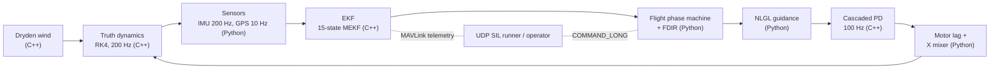

# Talon: Single-Vehicle UAV Autopilot and Path Follower

Talon is a complete guidance, navigation, and control (GNC) stack for a
1.5 kg Crazyflie-class quadrotor: a 15-state multiplicative error-state
Kalman filter, NLGL line-of-sight guidance, a cascaded PD autopilot, an
8-state flight-phase state machine with FDIR, and a UDP MAVLink
software-in-the-loop (SIL) runner, all closed loop against a C++17
rigid-body truth plant. The computational kernel (dynamics, Dryden wind,
controller, EKF) is header-only C++17 exposed through pybind11; the
mission, guidance, estimation glue, SIL, and analysis tooling are
Python. Talon is the single-agent companion to SwarmGNC: where SwarmGNC
studies multi-agent formation flight, Talon proves one vehicle done
honestly, estimator in the loop, with every acceptance number checked by
an automated report.

## Highlights

- **15-state MEKF**: position, velocity, attitude (multiplicative error),
  gyro bias, accel bias; chi2-gated 10 Hz GPS updates, covariance-based
  convergence and divergence detection.
- **Cascaded PD autopilot** at 100 Hz with zero-order hold: altitude /
  velocity outer loop, attitude / rate inner loop, saturating mixer-aware
  commands, 200 Hz RK4 truth with first-order motor lag.
- **NLGL guidance** (Park, Deyst and How 2004, ArduPilot clipped form):
  look-ahead line-of-sight steering with ground-velocity Nu2, behind-A
  recovery, and per-leg cross-track diagnostics.
- **Flight-phase state machine**: IDLE, ARM, TAKEOFF, CRUISE, WAYPOINT,
  RTL, LAND, EMERGENCY with guarded transitions, an event audit log, and
  automatic critical-fault response to EKF divergence.
- **UDP MAVLink SIL**: real MAVLink v2 frames (pymavlink codec) for
  telemetry (HEARTBEAT, ATTITUDE, LOCAL_POSITION_NED, GPS_RAW_INT,
  BATTERY_STATUS) and COMMAND_LONG events on loopback ports 14550/14551,
  plus fault injection (GPS outage, EKF corruption, battery drain).
- **6 closed-loop scenarios** with printed acceptance metrics, plus a
  Phase 6 validation driver that runs everything, generates seven
  publication plots, and writes an automated validation report.
- **Test suites**: 139 pytest tests and 31 Google Tests, all passing.

## Architecture

Data flow of one 200 Hz SIL step (sensors and estimator at their own
rates, controller at 100 Hz):



Module ownership (single source of truth per layer):

| Layer | C++17 kernel (`cpp/include/talon/`) | Python (`src/talon/`) |
|-------|--------------------------------------|------------------------|
| Dynamics / RK4 | `dynamics.hpp` (`propagate`) | re-export only |
| Wind | `wind.hpp` (`DrydenWind`) | re-export only |
| Controller | `controller.hpp` (cascaded PD) | `controller.py` binding |
| Estimator | `ekf.hpp` (15-state MEKF) | `ekf.py` binding |
| Motors | constants in `constants.hpp` | `motors.py` (lag + mix) |
| Sensors | constants | `sensors.py` (truth-side IMU/GPS) |
| Guidance / mission | - | `guidance.py` (NLGL), `mission.py` |
| State machine / FDIR | - | `state_machine.py` |
| SIL + MAVLink | - | `mavlink_sil.py`, `mavlink_codec.py` |
| Battery | - | `battery.py` |
| Plots / report | - | `plotting.py`, `sims/run_all.py` |

## Build and test

The native extension `talon._core` is built by CMake (not by the Python
build backend). From the repository root:

```bash
# Build the C++ kernel, GTest binary, and the pybind11 module
# (drops _core*.so into src/talon/). Run under `uv run` or with the
# virtualenv active so CMake picks the same interpreter as the tests:
uv run cmake -B build -DCMAKE_BUILD_TYPE=Release
uv run cmake --build build -j

./build/talon_tests              # 31 C++ unit tests (Google Test)

uv sync                          # Python environment (.venv)
uv run pytest tests/ -q          # 139 Python tests

uv run python sims/run_all.py    # all 6 scenarios + plots/ + validation report
```

Individual scenarios also run standalone, for example
`uv run python sims/scenario_waypoints.py`. The validation driver writes
`plots/*.png` and `plots/validation_report.md` (the plots/ directory is
gitignored; regenerate on demand).

## Scenarios

| Scenario | Purpose | Key metric |
|----------|---------|------------|
| `scenario_hover` | Cascaded PD closed-loop hover with motor lag, calm air | steady-state drift < 0.05 m (achieved < 0.001 m) |
| `scenario_waypoints` | NLGL 40x30 m rectangle at 10 m under Dryden wind, full EKF-in-the-loop stack | mean cross-track 0.63 m, EKF RMSE 0.10 m |
| `scenario_rtl` | Low-battery fault injection, return-to-launch, gentle touchdown | 0.40 m/s touchdown, 0.05 m from home |
| `scenario_wind` | 60 s hover hold in 4-6 m/s airflow versus a calm baseline, SIL state machine | windy RMS 0.10 m inside the 0.26 m bound |
| `scenario_gps_outage` | 4 s mid-mission GPS blackout: dead-reckon, reconverge, no EMERGENCY | 0.63 m error growth, < 0.1 s reconvergence |
| `scenario_emergency` | EKF position corruption at hover: FDIR detection and controlled descent | detection 0.00 s, soft settled landing |

## Validation summary

Headline numbers from `uv run python sims/run_all.py` (the full 24-row
table lands in `plots/validation_report.md` on every run):

| Metric | Target | Achieved |
|--------|--------|----------|
| Hover steady-state drift | < 0.05 m | < 0.001 m |
| Position step rise time / overshoot | < 2.5 s / < 10 % | 1.37 s / 2.7 % |
| EKF position RMSE (windy circuit) | < 2.0 m | 0.10 m |
| Gyro bias estimate (max axis) | < 0.01 rad/s | 0.0018 rad/s |
| NLGL mean / max cross-track (after 15 s) | < 1.0 m / < 3.0 m | 0.63 m / 1.95 m |
| Waypoints reached | 5 of 5 | 5 of 5 |
| RTL touchdown: horizontal / vertical speed | < 3 m / < 0.5 m/s | 0.05 m / 0.40 m/s |
| Wind hover RMS (vs baseline-scaled bound) | < 0.26 m bound | 0.10 m |
| GPS outage error growth / reconvergence | < 5 m / < 5 s | 0.63 m / < 0.1 s |
| Emergency detection / final altitude | < 1 s / < 0.5 m | 0.00 s / settled |
| State machine phases covered (SIL union) | 8 of 8 | 8 of 8 |
| Test suites | 139 pytest + 31 GTest | all passing |

Two example plots (generated by the validation driver into the gitignored
`plots/` directory; regenerate with `uv run python sims/run_all.py`):


*3D NED truth trajectory with waypoint and home markers: takeoff climb,
two 40 m legs at 10 m, then the RTL climb-over-home and descent. The
cross-track samples for both legs come from the NLGL diagnostics.*


*Flight-phase Gantt from the emergency scenario: the corrupted EKF
estimate trips `critical_fault` at 20 s, the machine owns a controlled
descent through EMERGENCY and LAND, and the settled vehicle returns to
IDLE. Dotted lines are accepted guarded events; down-ticks are rejected
attempts in the audit log.*

Note: `plots/` is gitignored, so the two images embedded above do not
render on GitHub. Generate them locally with
`uv run python sims/run_all.py` and open `plots/*.png` on disk.

## Frames and conventions

NED world frame, aerospace body frame, Hamilton scalar-first
quaternions, thrust along -body-z, gravity [0, 0, +g] in NED. The full
single source of truth for frames, signs, units, and the motor mixer is
[docs/conventions.md](docs/conventions.md); every C++ header and Python
module is checked against it.

## Guidance note

Talon's guidance law is Nonlinear Linear guidance (NLGL) in the form of
Park, Deyst and How (2004), implemented in the scalar ArduPilot
AP_L1_Control style: look-ahead distance L1 = zeta * T * V / pi, a
clipped cross-track capture angle Nu1, and a course error Nu2 measured
from the EKF ground-velocity vector (mandatory for wind immunity: the
crab angle cancels exactly in Nu2). The commanded course is
chi_d = chi_q + Nu with Nu clipped to +/-90 deg, the ArduPilot form that
keeps L1 globally convergent; the unclipped Nu1 + Nu2 sum has a
wrong-way equilibrium at corners. Altitude rides a separate P/PD channel
on the active waypoint's NED z. Waypoint sequencing, acceptance radii,
and the first-leg start-position rule live in `talon.mission`; the law
itself is a pure function with per-call diagnostics (`e_ct`, `nu1`,
`nu2`, `l1`, `chi_d`).

## Talon versus SwarmGNC

| Aspect | Talon | SwarmGNC |
|--------|-------|----------|
| Scope | Single vehicle, full onboard GNC | Multi-agent swarm, coordination research |
| Navigation | 15-state MEKF (GPS + IMU, bias estimation) | Truth-state (formation study isolates control) |
| Control | Cascaded PD with motor lag and mixer saturation | LQR consensus controllers |
| Guidance | NLGL line-of-sight path following | DCM-based formation keeping |
| Fault handling | FDIR state machine, emergency landing | Not in scope |

Talon and SwarmGNC are complementary portfolio projects: Talon is the
flagship flight-dynamics project proving estimation and control honesty
on one airframe; SwarmGNC remains the active project for multi-agent
work.

## Portfolio narrative

Talon is the flagship of the flight-dynamics portfolio: a single-vehicle
autopilot where the estimator is in the loop, the wind is modeled, the
faults are injected, and every headline number is produced by an
automated report rather than by hand. SwarmGNC remains the active
project for multi-agent formation flight; Talon is what makes the
single-agent layer underneath that research trustworthy.

## References

1. Beard, R. W. and McLain, T. W. *Small Unmanned Aircraft: Theory and
   Practice*. Princeton University Press, 2012. (Cascaded autopilot
   design, path following, Dryden wind model.)
2. Trawny, N. and Roumeliotis, S. I. "Indirect Kalman Filter for 3D
   Attitude Estimation." University of Minnesota, GRASP Laboratory,
   2005. (MEKF formulation used by `ekf.hpp`.)
3. Solà, J. "Quaternion kinematics for the error-state Kalman filter."
   arXiv:1711.02508, 2017. (Multiplicative error-state conventions.)
4. Park, S., Deyst, J. and How, J. P. "Performance and Lyapunov
   stability of a nonlinear path-following guidance law." *AIAA Journal
   of Guidance, Control, and Dynamics*, 2007 (with the 2004 conference
   precursor). (NLGL guidance law.)
5. Nelson, D. B. *Flight Stability and Automatic Control*. McGraw-Hill,
   1998. (Aerospace frame and rigid-body context.)
6. Groves, P. D. *Principles of GNSS, Inertial, and Multisensor
   Integrated Navigation Systems*. Artech House, 2013. (GPS measurement
   modeling and sensor fusion practice.)
7. MIL-F-8785C. *Military Specification: Flying Qualities of Piloted
   Airplanes*. (Turbulence severity context for the Dryden spectrum.)
8. Quan, Q. *Introduction to Multicopter Design and Control*. Springer,
   2017. (Quadrotor modeling, mixer, and motor dynamics.)
9. Mellinger, D. and Kumar, V. "Minimum snap trajectory generation and
   control for quadrotors." *IEEE ICRA*, 2011. (Reference for
   trajectory-tracking performance expectations on small quadrotors.)
10. Lee, T., Leoky, M. and McClamroch, N. H. "Geometric tracking
    control of a quadrotor UAV on SE(3)." *IEEE CDC*, 2010.
    (Geometric-control contrast to the cascaded PD used here.)

## Layout

```
Talon/
├── CMakeLists.txt          # kernel + GTest + pybind11 build
├── pyproject.toml          # uv-managed Python deps
├── bindings/pytalon.cpp    # pybind11 module talon._core
├── cpp/
│   ├── include/talon/      # header-only C++17 kernel
│   │   ├── dynamics.hpp    #   RK4 rigid-body propagate
│   │   ├── wind.hpp        #   Dryden turbulence
│   │   ├── controller.hpp  #   cascaded PD autopilot
│   │   ├── ekf.hpp         #   15-state MEKF
│   │   ├── types.hpp       #   State, Quaternion, params
│   │   └── constants.hpp
│   └── tests/              # Google Test suites (31 tests)
├── docs/conventions.md     # frames, signs, units (single source)
├── sims/
│   ├── scenario_*.py       # 6 closed-loop scenarios
│   └── run_all.py          # Phase 6: validation driver + report
├── src/talon/              # Python package
│   ├── mavlink_sil.py      # UDP MAVLink SIL runner + fault injection
│   ├── guidance.py         # NLGL law
│   ├── mission.py          # waypoint sequencing
│   ├── state_machine.py    # flight-phase machine + FDIR hooks
│   ├── sensors.py          # truth-side IMU/GPS models
│   ├── motors.py           # motor lag + X mixer
│   ├── battery.py          # battery model
│   ├── plotting.py         # Wong-palette publication plots
│   └── _core*.so           # built by CMake (not committed)
└── tests/                  # pytest suites (139 tests)
```

## License

Talon is a portfolio project. It is shared for evaluation and learning;
no open-source license is granted by default. Reach out if you want to
reuse part of it.
